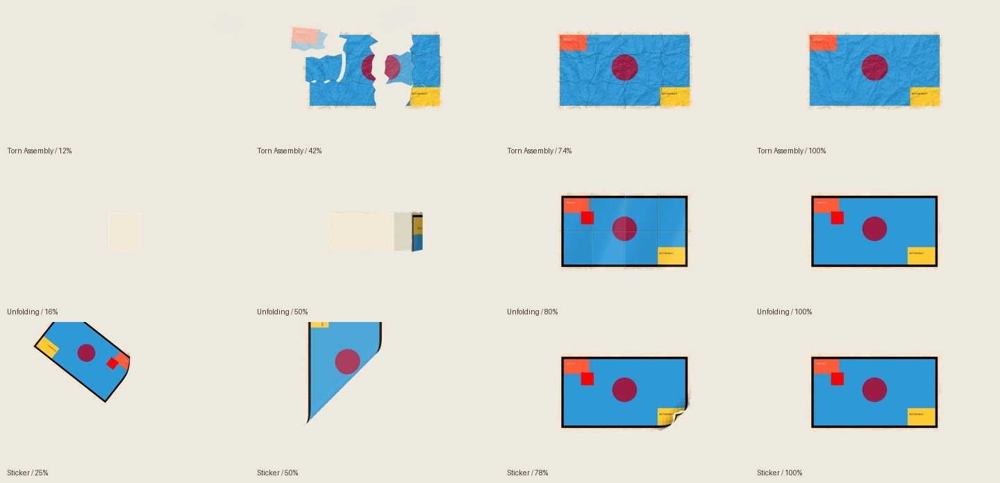

# Ancap Bulletin editing

A Codex skill for creating HyperFrames videos with a consistent handcrafted paper/newspaper identity. It includes paper treatment and Torn Assembly, deterministic unfolding and sticker intros, existing hand/ball assets, and narration/audio guidance.

Read [SKILL.md](SKILL.md). For setup and commands, see [generator usage](references/generators.md).

Every transition uses its fixed, quiet local sound at **gain 1** (the level is baked into the WAV):

| Transition | Sound | Peak |
| --- | --- | ---: |
| Hand | [hand.wav](assets/transitions/audio/hand.wav) | −24.05 dBTP |
| Crumbled paper ball | [crumpled-ball.wav](assets/transitions/audio/crumpled-ball.wav) | −26.05 dBTP |
| Pieces join / Torn Assembly | [torn-assembly.wav](assets/transitions/audio/torn-assembly.wav) | −24.05 dBTP |
| Unfolding | [unfolding.wav](assets/transitions/audio/unfolding.wav) | −26.05 dBTP |
| Sticker intro | [sticker.wav](assets/transitions/audio/sticker.wav) | −24.05 dBTP |

Finished videos target **−14 ±1 LUFS**, true peak **≤−1 dBTP**. [Audio details and sources](references/audio.md).

[Validation and independent review](references/validation.md).

Epidemic Sound WAVs are licensed account assets: keep them private when publishing the skill; they are not a redistributable sound library.
