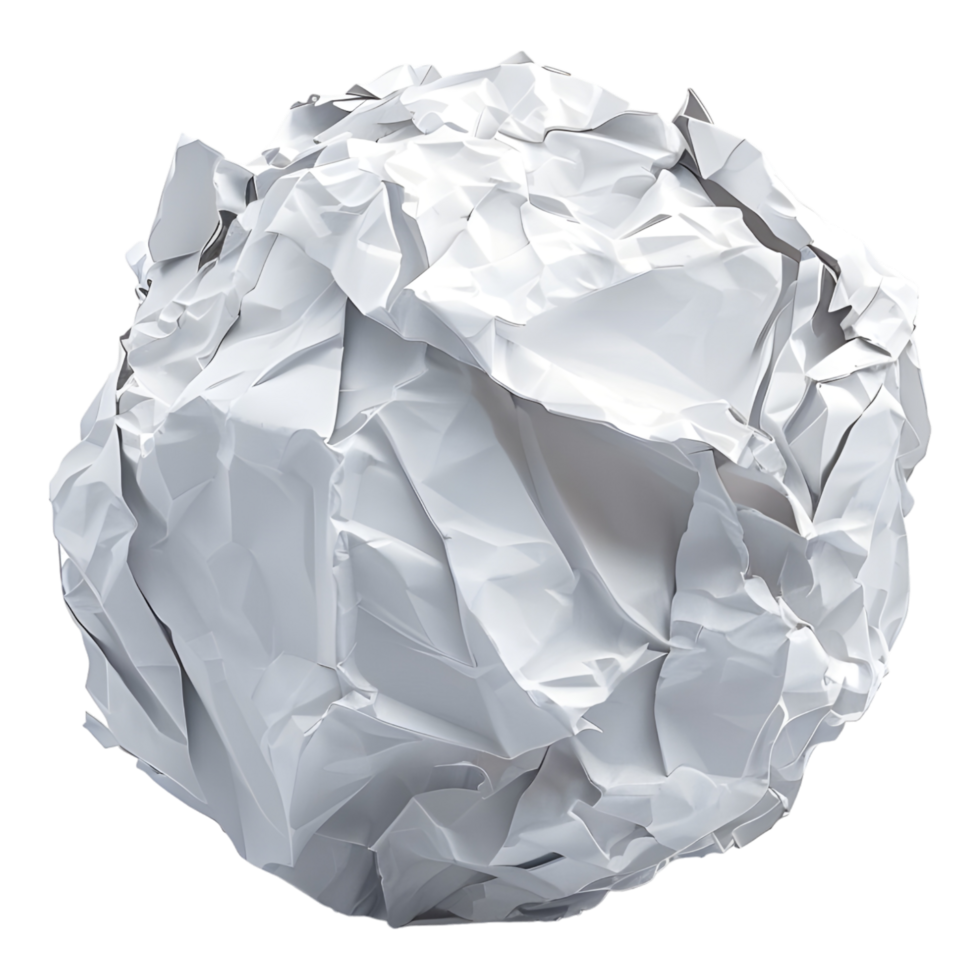
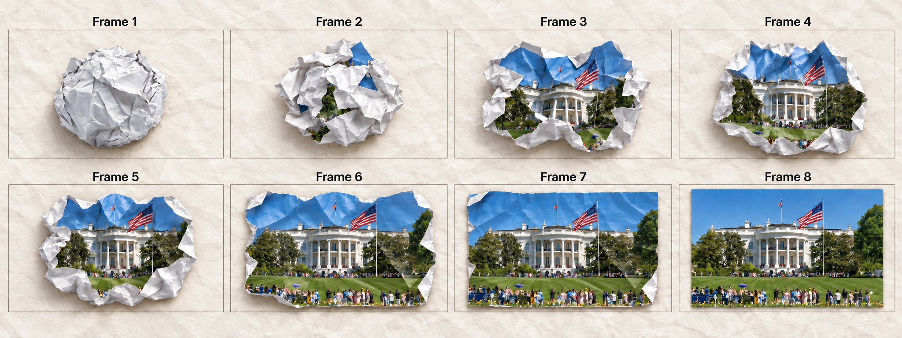

# Ancap Bulletin editing

Igor is a senior Flutter/Dart developer building a mostly faceless channel about anarcho-capitalism and libertarianism. Explain how free markets can address real-world problems through accessible language, practical examples, and solid arguments. Narration, visuals, and content lead; Igor generally does not appear on camera.

## Editing style

Use a handcrafted paper/newspaper collage identity: warm paper stock, irregular cut edges, subtle crumpled relief, and physical paper motion. This supports the **Bulletin** name. Keep the same treatments and sounds across the channel.

Use HyperFrames and its relevant installed skills. All paths below resolve **from this skill's folder**, not the current video project's working directory. Copy the needed assets/output folder into the video project; keep its internal relative paths intact. Read [generator usage](references/generators.md) before executing a script; setup is once per installation.

## Background

Use the fixed warm off-white crumpled paper with subtle fibers and shallow crease shadows for most scenes. Choose [horizontal, 1920×1080](assets/backgrounds/crumpled-paper-horizontal.mp4) or [vertical, 1080×1920](assets/backgrounds/crumpled-paper-vertical.mp4) according to the video's orientation. Use another background when Igor explicitly requests it.

## Image assets — mandatory paper treatment

Use supplied assets, search online, or generate images as the scene requires. **Before passing ANY still image to ANY intro transition or placing it in a scene, run [scripts/paper.mjs](scripts/paper.mjs). Never skip this treatment merely because the image already has transparency.** It creates the consistent cut-paper edge and crumpled print. Only three exceptions are permitted:

- Igor explicitly requests an untreated image.
- The asset is a **video or animated GIF**: use a classic paper frame instead; never crumple its playing content.
- The still image fills the **entire video frame**, rather than being built into the scene.

Fixed treatment: **12 px border, tight crop on, Crumpled Newsprint, 20% crumple depth, 72 px fold size, zero color aging, no cast shadow**. Defaults: cut roughness **80%**, stock **classic**, background removal **false**. Change roughness or stock (`classic | cream | gray | tabloid`) only when requested. Enable `--remove-background` when asked, or when an online asset meant to be isolated actually has a background. Inspect its real alpha; a PNG extension or checkerboard picture does not prove transparency. The local remover handles border-connected flat backdrops; inspect its result and use a suitable removal tool for complex photographic backgrounds.

```sh
node "$SKILL_ROOT/scripts/paper.mjs" source.png paper.png
```

**Use the resulting `paper.png`, never the untreated source, as the image supplied to the transition.** Do this once; do not double-filter. Apply preprocessing to the artwork being introduced; use the supplied canonical hand sprites and ball pose references as provided. Embedded videos/GIFs always retain a classic paper frame for their entire visible duration, including after the intro. The unfolding/sticker scripts build that frame automatically from the first decoded frame.

# Transitions

Use the requested transition. Otherwise prefer **Hand** for isolated people/objects with genuine source transparency, **Crumbled paper ball** for complete images with backgrounds, and **Sticker intro** for embedded videos/GIFs. Unfolding and Pieces of paper join are situational or explicitly requested. Assets are in [assets/transitions/](assets/transitions/).

**Every transition MUST include its fixed local sound at the specified gain.** Do not re-search, substitute, loop, or normalize these files per use. Their very low levels are already baked in; `gain 1` means 0 dB additional gain. Keep the natural sound tail. Read [audio guidance](references/audio.md) for timing, provenance, and channel mixing. Omit sound only on an explicit request for silence.

## Hand drag transition
This is better when we have a image that has a transparent background, I recommend using this transition in that situation.
For example: I am talking about a real person and that the image of that person that I will use in the video to illustrate the point has a transparent background, the hand transition would be appropriate to introduce that image smoothly.
Another example is a image of a object, that will probably have a transparent background,  and in that case, the hand transition would be suitable to introduce that object smoothly as well.

Now, I will demonstrate how to use the hand transition effectively in a video.
The asset of the hand is in the codebase and it has 2 variations, the hand "closed", that gives the impression of grabbing or holding something, and the hand "open", that gives the impression of releasing or presenting something.
First, let's talk about the assets for the hand transition.
The assets for the hand transition are as follows:
- [Open hand image](assets/transitions/hand_transitions/hand-open.png)
- [Closed hand image](assets/transitions/hand_transitions/hand-closed.png)
Note that each image has the same dimensions and resolution, ensuring consistency when using them in the hand transition.

In the animation, the hand can come from any direction — top, bottom, left, or right — depending on the desired effect and the composition of the scene.
The animation of the hand transition involves moving the hand image from its starting position (out of the scene) to the target position, creating the illusion of interaction with the scene.
Use the closed hand image initially, with the asset and the end of the hand — this creates the impression of grabbing or holding the object. Once the object is in the target position in the scene, switch to the open hand image to give the impression of releasing the image asset in the scene — then move the hand out of the scene from the same point in entered, retracing its path, to complete the transition.
Use easing functions to make the hand movement appear more natural and fluid. For example, you can use ease-in for the hand entering the scene and ease-out for the hand exiting the scene.
The switch from one to other should have no animation, it should be instantaneous to maintain the illusion of interaction — just change one image to the other. 

Sound: [hand.wav](assets/transitions/audio/hand.wav), **gain 1**, baked peak −24.05 dBTP; play once at release.

## Hand drawing transition

For **still images only**, use [scripts/transition.mjs](scripts/transition.mjs) with `drawing` on the paper-treated PNG. The [pen-holding hand](assets/transitions/drawing/hand-pen.png) matches the open hand's style and 2012×781 canvas. Its precise native pen tip is **(1979, 582)**, recorded in [sprite metadata](assets/transitions/drawing/hand-pen.json); preserve that anchor.

```sh
node "$SKILL_ROOT/scripts/transition.mjs" drawing paper.png scene-drawing --angle 225 --duration 4
```

The eased transition spends **18% entering, 12% completely still at the drawing start, 63% drawing, and 7% exiting**. Zigzag strokes follow visible alpha spans and contours; transparent gaps are crossed with the pen lifted and no reveal. Default duration **4 s**; optional `--duration`, `--box` and `--hold` set scene timing/placement. Canvas/fps stay 1920×1080/24.

Choose `--angle` as an integer **0–360**, clockwise: 0° right, 90° bottom, 180° left, 270° top; 360° equals 0°. **Generally avoid cardinal angles**; choose an oblique entry suited to the image's placement. The script determines the quadrant, flips the hand deterministically, aligns its arm, and keeps the arm cutoff outside the frame. Do not replace this with a rectangular wipe. [Drawing details and example](references/drawing.md).

Sound: [drawing.wav](assets/transitions/audio/drawing.wav), **gain 1**, baked peak −26.05 dBTP; play once when drawing starts, at **30%**. The generated composition includes it and keeps its natural tail.

## Crumbled paper ball
This is the animation we will be using when we have an image that does not have a transparent background — unlike the hand transition, it is more suitable for images that are complete and not cropped objects.
The idea is: You'll use your image generation capacity to generate 5 versions of a intermediate frames between a totally crumpled paper ball and the open image asset that I want to show in the scene.
This animation will be like 2 seconds long, smoothly transitioning from the crumpled paper ball to the open image asset.
There will be 6 frames of image in this animation that will change one by one until the final result is in the scene.

The initial and last frames will be the same of the ball.
The first frame is of the ball totally crumpled, in this form it is not possible to see nothing of the image asset that will be revealed as the animation progresses.
The last frame will be the fully open image asset, the final result that will be visible in the scene.
Between it, I want 6 intermediate frames that gradually show the transition from the crumpled paper ball to the fully open image asset. Each frame should reveal a little more of the image asset (progressively less crumpled), creating a smooth and natural animation.
It is important to maintain consistent lighting and perspective across all frames to ensure the animation looks cohesive and realistic.
Try to visualize the crumpled paper ball gradually unfolding and revealing the image asset, frame by frame, until the final fully open image is displayed (the parts of the final image that appears in the crumbled version should gradually become visible).

About the first frame of the ball fully crubled, it is here: 


There is a visual reference that you can use as guide for creating the intermediate frames.

By the way, make sure to generate all frames with the same width, height and aspect ratio to ensure a consistent and smooth animation.

Make the changes consistent across all frames to maintain the illusion of a smooth unfolding animation.
Distribute the frames evenly over the 2-second animation to maintain a steady pace.

Sound: [crumpled-ball.wav](assets/transitions/audio/crumpled-ball.wav), **gain 1**, baked peak −26.05 dBTP; play once from reveal start.

## Pieces of paper join animation

Use [scripts/transition.mjs](scripts/transition.mjs) with `torn` on the **paper-treated image**. This preserves the **Torn Assembly** piece geometry, seed, alpha scheduling, easing, torn stock layers, seam fade, and final hold. All fragments stay inside the frame. Do not recreate its logic by hand. [Implementation details](references/rendering.md).

```sh
node "$SKILL_ROOT/scripts/transition.mjs" torn paper.png scene-torn
```

Canvas is always **1920×1080**, frame rate always **24 fps**. Default duration **2.8 s**; change `--duration` only for a specific requested timing. `--flow` accepts `center | topToBottom | bottomToTop | leftToRight | rightToLeft`: choose `leftToRight` for left-side artwork, `rightToLeft` for right-side artwork, and `center` for a central/emphasized image. Use vertical flows sparingly, for artwork very high/low or an explicit request. Default `--motion direct` is mandatory unless Igor **explicitly requests Page Riffle** (`--motion pageRiffle`). Use `--box x,y,width,height` for final placement; do not change canvas size or fps.

Sound: [torn-assembly.wav](assets/transitions/audio/torn-assembly.wav), **gain 1**, baked peak −24.05 dBTP; start with the reveal. The generated composition already includes it.

## Image/Video "unfolding" animation

Use [scripts/transition.mjs](scripts/transition.mjs) with `unfold`. Supply the paper-treated image, or the original video/GIF (the script extracts its first frame and adds the classic stock border). The paper enters from outside as one compact folded packet, opens through four columns and two rows, and reaches a flat sheet **with visible fold creases**. The **last 20%** fades those creases out. Default duration **3.2 s**.

```sh
node "$SKILL_ROOT/scripts/transition.mjs" unfold clip.mp4 scene-unfold --origin center
```

`--origin bottomLeft | bottomRight | topLeft | topRight | center` chooses the starting corner. `center` keeps the unfolding packet centered on its final occupied area after arrival. Canvas/fps remain 1920×1080/24; optional `--duration` and `--box` control timing and placement. [Motion details](references/motion.md).

For video/GIF, the completed first frame switches seamlessly to playback in **exactly the same content rectangle**, surrounded by the same frame. Loop unless Igor requests otherwise (`--no-loop`). HyperFrames owns playback; never manually call `play()` or seek media. Keep the frame during playback.

Sound: [unfolding.wav](assets/transitions/audio/unfolding.wav), **gain 1**, baked peak −26.05 dBTP; start with the reveal. The generated composition already includes it.

## Video "sticker intro" animation

Use [scripts/transition.mjs](scripts/transition.mjs) with `sticker` for embedded video/GIF. It extracts the first frame and adds the classic paper border. The horizontally mirrored sheet enters from outside, bends through a diagonal curl, and adheres progressively **from the top-left corner**, correcting its orientation as it settles. This must visibly fold, rather than act as a flat wipe or scale reveal. Default duration **2.8 s**.

```sh
node "$SKILL_ROOT/scripts/transition.mjs" sticker clip.mp4 scene-sticker
```

Canvas/fps remain 1920×1080/24; `--duration` and `--box` control timing and placement. Once adhered, replace the still with the video/GIF in exactly the same rectangle and keep its classic frame. Loop unless explicitly requested otherwise (`--no-loop`). The generated composition performs this handoff and uses framework-owned playback. [Motion details](references/motion.md).

Sound: [sticker.wav](assets/transitions/audio/sticker.wav), **gain 1**, baked peak −24.05 dBTP; play once at first surface contact. The generated composition already includes it.

# Transcription

**Mandatory for every scene:** obtain narration transcription before editing, with word timestamps in context, and align visual entrances, emphasis, music changes, and SFX to those words. Use the configured local **WhisperX, model `large-v3-turbo`**. Check apparent transcription mistakes against the script/topic; preserve the narration's actual wording. Every scene has voice narration while its visuals play.

# Audio

Narration comes from **ElevenLabs**. Use Epidemic Sound MCP for scene-appropriate music and additional SFX: choose music for the mood of each part (intro, main content, outro), rather than automatically using one track for the whole video. Use additional effects selectively; they are not needed in every scene. The transition sounds above are fixed local assets and always accompany their transitions.

**Across the whole channel, master every finished video to −14 LUFS integrated (±1 LU), maximum true peak ≤−1 dBTP, 48 kHz.** Measure the whole exported mix and verify again after encoding. LUFS is perceived loudness; dBTP is true-peak level, neither is a volume percentage. This is our channel target, not a compulsory YouTube upload specification.

Start narration around **−16 LUFS integrated**, peaks ≤−3 dBTP before mastering. Keep music under speech **18–24 LU quieter** over the same active 3-second window (roughly −34 to −40 LUFS short-term when speech is −16). Start other SFX with peaks **−24 to −18 dBTP** and prefer the quieter end. These are mixing starting points; dialogue must remain clear. Keep neighboring narration phrases consistent, duck music/effects around words, then master the whole mix together. Fixed transition sounds remain at the gains specified above. Read [audio guidance and sources](references/audio.md) before mixing or mastering.

# Texts and fonts
Of course, sometimes I will ask you to add texts to the video.
The default font will be the [Special Elite typeface](assets/fonts/SpecialElite-Regular.ttf), which resembles old typewriter text and complements the paper collage aesthetic of the channel. Use the bundled font at weight 400. The way I expect the text to appear is like a typewritter, with each character appearing sequentially as if being typed in real-time.
A very common pattern, when using "Special Elite", that I will ask you to do is creating a dialogue like if the user is asking something or two people are talking, and for those cases I want you to make a line detail that points from the text to the character or object speaking in a animation way, ensuring it is clear who is speaking at any given moment.

## Magazine font — explicit request only

When Igor asks for the **“magazine font”**, he means **Magazine Mix with Shuffle letter styles**: colored magazine clippings whose individual letter styles change while their positions stay fixed. **Use it only when the user explicitly requests it; never choose it automatically.** Keep Special Elite and the standard emphasis lettering as the usual choices.

Use [scripts/magazine.mjs](scripts/magazine.mjs) with **`--duration` required, no default**: pass the entire time this text will be visible. Shuffle interval defaults to **0.52 s**, configurable with `--interval`; output is transparent at **24 fps**. Read [magazine font setup](references/magazine.md) for the bundled artwork, fallbacks and native helper. These clippings already include their paper; do not apply the image filter again.

## Emphasis text
This is used to highlight important words or phrases within the text.
The emphasis text will have a different font: [Inter Black](assets/fonts/Inter-Variable.ttf), weight 900 and optical size 32. Render it with [scripts/emphasis.mjs](scripts/emphasis.mjs) or the [native lettering helper](assets/text/emphasis.js): heavy upright dark letters on overlapping cream paper scraps, with a different paper position, height, torn edge and rotation behind each letter. Keep these paper variations fixed while the word is visible. Read [text setup and example](references/text.md) for the font loading and word timing.
When using it, I want to have the 2 patterns that you should follow.

### Pattern 1: Word-by-Word Emphasis
If I ask to show word by word you will immediately change scene to only the background (removing the items in scene previously) and then display VERY BIG in the middle of the screen ONLY THE WORD (nothing else) for the duration of that word in the transcript of the audio.
So let's say I ended showing a schene and then you detect that the next phase of AI is something like "Who did this?", you can detect that it is a part of the script that I am changing topic/scene and by this you can deduce that you can use this text edit style and show each word in the middle of the screen as it is spoken in the audio (thats why having the transcription and time that the words appear is very important). So the moment the audio says "who", you display "WHO" in the middle of the screen, and then continue with the next word as it is spoken.
This creates a good sense of anticipation for the viewer, as they can follow along with the text in real-time as it is being spoken.

### Pattern 2: Phrase Emphasis with blur background
You see: there are 2 types of moment in the video: when I create expectation with a phase of whats comming in the next "section" of the video, and when I deliver the information.
In both moments of creating expectations I can use the pattern 1 or 2, but for longer phrases, pattern 2 is more suitable since it shows more words at the screen at the same time, not only 1 word — in long phases were the user needs to read and comprehend more information, this approach ensures clarity and maintains viewer engagement (since that in the first pattern the viewer might struggle to keep up with the rapidly changing words, and when we are showing the last word maybe we already "forgot" the beginning of the phrase).

Now, let me explain the composition of a typical scene using these emphasis patterns.
There will be the scene composition, which typically includes the background, characters or objects, and texts. I want that scene to continue to be appearing but it will be blured (make the blur appear in a fade in effect). And then, with everything of the scene blurred, I will display the emphasized phrase — but I will display word by word, keeping the previous words visible (unlike Pattern 1, which replaces each whole word), starting in the top left and moving towards the bottom right as the words are spoken. Arrange the words in a way they fit well.
Blur only the existing scene layer; keep the emphasized letters and their paper sharp above it. Each whole word and its paper appear together at that word's timestamp. Plan the full phrase layout before revealing it so earlier words do not move when later words appear.
Important: you can separate the phase in 2 parts or more if you want to ensure readability and proper pacing for the viewer. So if a phase was, let's say, 18 words, you can show the first 6 words and then the remaining 7 words separately and then 5 in the last part — allways maintaining the unfocused background, so the phase part appears word by word to the end of that part and then it goes to the next one, this way the viewer can comfortably read and comprehend the emphasized phrase.
Then, so a slide transition to the next scene so the video can continue smoothly, maintaining the viewer's engagement and ensuring a seamless visual experience for the entire video.

## Pattern 1.5: Hybrid approach
This is a hybrid approach of Pattern 1 and Pattern 2.
This is when I have a longer phase, but the start of it is a hoot-take or a strong hook that needs immediate emphasis. So in this case we can mix the patterns 1 and 2 by, like the pattern 2, blurring the background, and then showing the initital hook word by word in the middle of the screen (like Pattern 1, but with the blur background scene instead of a plain background), and once the hook is delivered, continue with the rest of the phrase using the pattern 2 approach. If the hook is in the end of the phase, you can invert the patterns as well.

# HyperFrames integration

Use the generated `compositions/transition.html` as a sub-composition, or use its `index.html` to inspect standalone. Copy the whole output directory. Each output includes transparent VP9 WebM, the exact final PNG, media rectangle metadata, a fixed sound track, and video/frame layers when applicable. **Do not use only `animation.webm` and forget the sound or final hold.** Read [generator usage](references/generators.md) for mounting, frame rounding, loop behavior, and alpha verification. Check and inspect the assembled HyperFrames scene before delivery.
