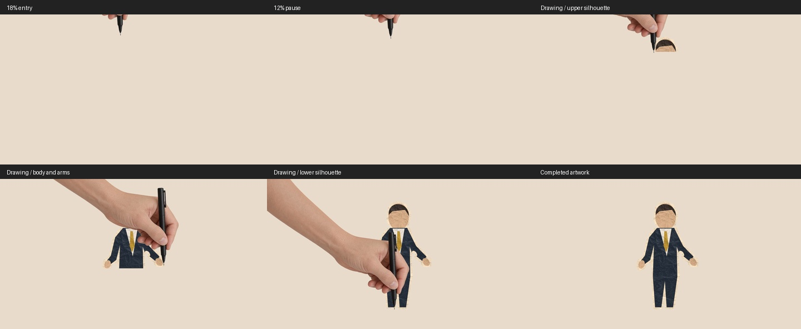

# Hand drawing

Supply the **paper-treated still**, using a fresh output directory:

```sh
node "$SKILL_ROOT/scripts/transition.mjs" drawing paper.png scene-drawing \
  --duration 4 --angle 225 --box 500,200,900,700 --hold 6
```

Output follows the [shared generator contract](generators.md): transparent 1920×1080/24 fps VP9 WebM, exact final PNG, manifest, fixed sound and ready HyperFrames composition. Mount `bulletin-drawing`. The default intro is 4 s; set the hold to the scene's remaining visible time. Video and GIF inputs are rejected.



## Motion and geometry

| Phase | Duration | Behavior |
| --- | ---: | --- |
| Enter | 18% | Ease from completely offscreen to the first visible source pixel |
| Pause | 12% | Pen stays exactly at that point; artwork stays unrevealed |
| Draw | 63% | Eased alternating strokes across actual visible alpha spans |
| Exit | 7% | Full artwork stays fixed while the hand eases offscreen |

The first point is selected from the silhouette toward the entry direction. Each stroke stays on visible image pixels. Transparent holes split spans; connecting travel lifts the pen and reveals nothing. Thin protrusions and tiny disconnected islands receive planned dabs beside the neighboring sweep. The brush is clipped by the original source alpha, so transparent areas remain transparent. Coverage is checked before rendering; completion needs no missing-pixel reveal. The pose and cumulative mask both derive from the same eased progress, including backward seeks.

Use `--angle` as an integer from 0 through 360. Angles run clockwise: 0° right, 90° bottom, 180° left, 270° top; 360° normalizes to 0°. Prefer oblique angles based on scene placement, **generally avoiding 0°, 90°, 180° and 270°**. Quadrants have explicit boundaries:

| Normalized angle | Entry quadrant | Current hand reflection |
| --- | --- | --- |
| 0 ≤ angle < 90 | Bottom right | X and Y |
| 90 ≤ angle < 180 | Bottom left | Y |
| 180 ≤ angle < 270 | Top left | None |
| 270 ≤ angle < 360 | Top right | X |

The script derives reflections from the native arm direction, aligns it to the selected angle, and scales the long arm so every cut-edge pixel stays outside the frame while drawing. The image's fitting rectangle preserves its aspect ratio.

## Pen anchor

[hand-pen.png](../assets/transitions/drawing/hand-pen.png) is **2012×781**, matching the open-hand canvas. The nib's native anchor is **x=1979, y=582**, using the top-left image origin; [metadata and generation prompt](../assets/transitions/drawing/hand-pen.json) include its hash and reference. The renderer translates to the reveal point, then rotates/reflects/scales around this exact anchor. Do not round intermediate coordinates, guess an anchor after resizing, or replace the sprite without remapping its tip. The generator rejects a changed sprite hash.

[drawing.wav](../assets/transitions/audio/drawing.wav) plays once at **30% of the transition**, when drawing begins, at **gain 1 / baked −26.05 dBTP**. Keep its natural tail; shorter intros may extend the scene to accommodate it. No per-use looping or stretching.
