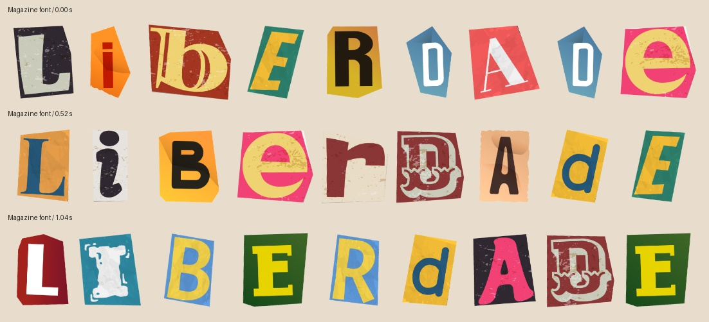

# Optional magazine font

Use **only when the user explicitly requests magazine lettering or the magazine font**. This is an optional text treatment; the regular emphasis paper lettering remains the default. These colored paper clippings already contain their print and texture: do not run them through the image paper filter.



```bash
node "$SKILL_ROOT/scripts/magazine.mjs" "YOUR STORY" /path/to/new-output --duration 4
node "$SKILL_ROOT/scripts/magazine.mjs" "Liberdade, ação!" /path/to/new-output --duration 5.2 --interval 0.7 --size 112
```

`--duration` is **required**, with no default. Output is always **1920×1080 at 24 fps**. Letter styles shuffle every **0.52 s** by default; `--interval` changes the interval (0.08–2 s, rounded to a 0.02 s step). `--size` defaults to 112 px; `--seed` defaults to 47. Duration rounds up to complete 24 fps frames; the manifest records both values. Choose a fresh output directory.

The output contains a transparent `animation.webm`, first/final PNGs, a manifest, and a ready HyperFrames `index.html` with `compositions/magazine.html`. Copy that output folder into the video project and place the sub-composition at the desired time. Keep its composition ID and timeline key consistent and unique when using several instances. The framework owns WebM playback; it stays transparent over the scene. This treatment adds no sound automatically.

Each glyph cycles through the three original atlas looks in a seeded order. Glyph positions reserve the widest variant and never move or reflow when styles swap; the artwork's small rotations, colors, folds, and wear are preserved. Either typed case selects the atlas's supplied mixed-case artwork. X falls back to the first atlas when missing from the third. Unsupported punctuation, numerals, and accents retain their characters through seven bundled fallback fonts and the same seeded paper/ink colors; they are never discarded or transliterated.

For native canvas use, import `prepareMagazine` from [assets/text/magazine.js](../assets/text/magazine.js), then `await prepareMagazine({ text, duration, shuffleInterval: 0.52 })`. It loads local atlases and fonts before measuring. Append `scene.canvas`; call `scene.render(localSeconds)` from the composition's single paused timeline. It renders directly from the timestamp, including backward seeks; `scene.renderStill()` shows the initial style. Keep the helper, [magazine assets](../assets/magazine/README.md), and shared fonts at their relative paths. Font size and optional box/alignment/spacing settings control layout once, before rendering; check `scene.overflow`.
